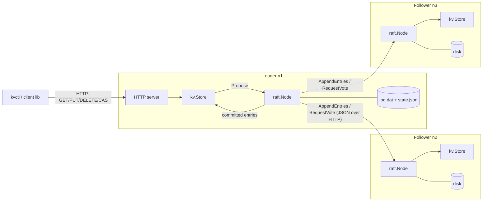

# raft-kv

[](https://github.com/chiru-6/raft-kv/actions/workflows/ci.yml)


A distributed, strongly consistent key-value store built on my own implementation of the **Raft consensus algorithm** in Go, with no third-party dependencies.

Run three nodes, kill the leader, and the cluster elects a new one in about a quarter of a second without losing an acknowledged write. Restart the old leader and it catches up from its on-disk log.

```
$ kvctl put greeting "hello raft"        $ scripts/cluster.sh kill n1     # crash the leader
OK                                       $ kvctl put after-crash yes      # 0.28s, incl. re-election
$ kvctl cas -absent lock me              OK
swapped                                  $ kvctl status
$ kvctl cas lock you them                ADDRESS         ID  STATE        TERM  LEADER  COMMIT
not swapped (current value: "me")        127.0.0.1:8001  -   unreachable
                                         127.0.0.1:8002  n2  follower     2     n3      7
                                         127.0.0.1:8003  n3  leader       2     n3      7
```

## Features

**Raft core** (`raft/`)
- Leader election with randomized timeouts, plus **Pre-Vote** (Raft thesis §9.6), so a node that was partitioned away can't disrupt a healthy leader when it comes back.
- Log replication with batching and **fast conflict backtracking**: a follower reports the conflicting term, so the leader skips a whole term per round trip instead of a single entry.
- Commit rule from §5.4.2: only entries from the current term are committed by counting replicas. A no-op entry is appended at the start of each term so older entries commit too.
- **Durable storage**: an append-only log of CRC32-checksummed records and an atomically replaced `state.json`. A torn or corrupt tail left by a crash is detected and cut off on startup.
- **Group commit**: the leader appends without waiting for disk and fsyncs in the background, counting itself toward the quorum only once its copy is durable. One fsync covers every proposal that arrived during the previous one, giving **~3× higher durable write throughput** (see [Benchmarks](#benchmarks)).

**Key-value service** (`kv/`, `server/`)
- **Linearizable** `GET`, `PUT`, `DELETE` and **compare-and-swap**. Reads go through the Raft log too. An optional `?stale=true` read is served from any replica's local copy.
- **Exactly-once writes**: each request carries a client ID and sequence number, and replicas remember the last result per client, so a write retried after a timeout or failover is never applied twice.
- Followers answer with a `307` pointing at the leader, and the Go client and CLI follow it automatically.

**Tooling**
- `kvnode` runs a server node, `kvctl` is the CLI client, and `kvbench` is a load generator with latency percentiles.
- `scripts/cluster.sh` starts, kills and restarts a local 3-node cluster.

## Architecture



The life of a write:

1. The client sends `PUT /kv/k` to any node. Followers redirect it to the leader.
2. The leader's `kv.Store` encodes the command and calls `raft.Node.Propose`. The entry is appended to the leader's log, and replicators send it to followers in batches.
3. Each follower checks that its log matches the leader's at `prevLogIndex`, appends the entry, **fsyncs it**, and acknowledges.
4. Once a majority, including the leader's own fsynced copy, holds the entry, it is committed. Every node applies committed entries in order to its in-memory map.
5. The waiting request sees its index applied. If the term matches, it returns the result. If a new leader overwrote the slot, it returns `503` and the client retries with the same sequence number.

Concurrency inside `raft.Node`: one mutex guards all state. There is a ticker goroutine for elections and heartbeats, one replicator per peer, an applier and a syncer. RPCs are sent with the lock released, and every reply is checked against the term it was sent in, so stale replies are ignored.

## Quick start

Requires Go 1.22+.

```bash
git clone https://github.com/chiru-6/raft-kv && cd raft-kv
scripts/cluster.sh start            # builds and starts n1..n3 on :8001-8003

./bin/kvctl put user:1 Chirandan
./bin/kvctl get user:1
./bin/kvctl status

scripts/cluster.sh kill n1          # crash a node (try the leader!)
./bin/kvctl put still working       # the cluster keeps serving with 2 of 3
scripts/cluster.sh restart n1       # it catches up from its log
scripts/cluster.sh clean            # stop everything and delete data
```

Running nodes by hand:

```bash
go build -o bin/ ./cmd/...
PEERS=n1=127.0.0.1:8001,n2=127.0.0.1:8002,n3=127.0.0.1:8003
./bin/kvnode -id n1 -peers $PEERS -data data/n1 &
./bin/kvnode -id n2 -peers $PEERS -data data/n2 &
./bin/kvnode -id n3 -peers $PEERS -data data/n3 &
```

### HTTP API

| Method & path | Body | Notes |
|---|---|---|
| `GET /kv/{key}` | | Linearizable read. Add `?stale=true` for a local read |
| `PUT /kv/{key}` | raw value | Up to 1 MiB |
| `DELETE /kv/{key}` | | `found` says whether the key existed |
| `POST /cas/{key}` | `{"expected":"a","value":"b"}` or `{"expectAbsent":true,"value":"b"}` | `ok` says whether it swapped |
| `GET /status` | | Raft role, term, leader, commit index and key count |

Add `X-Client-ID` and `X-Seq` headers to make writes idempotent across retries. The Go client does this for you.

```bash
curl -X PUT -d 'hello' localhost:8001/kv/greeting
curl localhost:8001/kv/greeting     # {"key":"greeting","value":"hello","found":true,"ok":true}
```

## Testing

```bash
go test -race ./...           # full suite, ~1 minute
go test -race -short ./...    # skip the slow chaos tests
```

The Raft tests run real nodes over an in-memory network (`raft/memnet.go`) that can disconnect nodes, split the cluster into partitions, drop messages and add latency. Every applied entry on every node is checked against every other node, so any **safety violation** (two nodes applying different commands at the same index) fails the test immediately.

| Test | What it proves |
|---|---|
| `TestInitialElection` | Exactly one leader, and it stays leader when nothing fails |
| `TestReElection` | A new leader takes over after a crash, the old one rejoins as a follower, and there is no leader without a quorum |
| `TestFollowerFailureAndCatchUp` | A follower that missed 50 entries catches up after rejoining |
| `TestNoCommitWithoutQuorum` | A leader cut off from the majority can't commit anything |
| `TestDivergentLogsAreRepaired` | A stale leader's uncommitted entries are overwritten by the majority's history |
| `TestPersistenceAcrossFullRestart` | The whole cluster restarts from storage with terms and logs intact |
| `TestPreVotePreventsDisruption` | Runs with and without Pre-Vote, showing that without it a rejoining node forces a needless election |
| `TestChaos` | Random crashes, restarts and partitions on a lossy, slow network while 3 clients propose, then the cluster must heal and agree |
| `TestFileStorage*` | Round trip, truncation, torn-write recovery and bit-flip detection |
| `TestConcurrentCASCounterUnderFailover` | 8 clients increment a counter with CAS over real HTTP while the leader is killed and restarted. The final value must equal the number of successful CAS operations |
| `TestRetriedWriteAppliedOnce` | A duplicated request is not applied twice, even after the key changes in between |

## Benchmarks

Measured with `kvbench -inproc`: real HTTP on loopback and a real on-disk log, with all nodes and clients on one **2-vCPU** cloud VM (ext4). 128-byte values over 1,000 keys, 8 seconds per run. Because everything shares two cores, treat these as relative numbers rather than what a cluster of separate machines would do.

| Nodes | Clients | Reads | fsync | Throughput (ops/s) | Write p50 | Write p99 | Read p99 |
|---:|---:|---:|:---:|---:|---:|---:|---:|
| 3 | 1 | 50% | on | 1,225 | 0.75 ms | 2.1 ms | 2.2 ms |
| 3 | 16 | 50% | on | 4,371 | 3.2 ms | 9.3 ms | 9.6 ms |
| 3 | 64 | 50% | on | 6,246 | 9.3 ms | 26.4 ms | 26.6 ms |
| 3 | 128 | 50% | on | 6,803 | 17.4 ms | 44.0 ms | 43.6 ms |
| 3 | 64 | 0% (writes only) | on | 6,044 | 9.4 ms | 27.7 ms | – |
| 3 | 64 | 90% | on | 7,866 | 6.9 ms | 24.0 ms | 23.5 ms |
| 3 | 64 | 50% | **off** | 16,756 | 3.4 ms | 11.9 ms | 12.0 ms |
| 5 | 64 | 50% | on | 5,119 | 11.4 ms | 29.6 ms | 29.6 ms |
| 3 | 64 | 90% **stale** reads | on | 15,231 | 8.8 ms | 23.2 ms | 10.7 ms |

**Group commit, before and after** (3 nodes, 50% reads, fsync on):

| Clients | fsync per proposal | Group commit | Speed-up |
|---:|---:|---:|---:|
| 1 | 782 ops/s | 1,225 ops/s | 1.6× |
| 16 | 1,954 ops/s | 4,371 ops/s | 2.2× |
| 64 | 2,147 ops/s | 6,246 ops/s | **2.9×** |

What the numbers show:

- **Durability is the main cost.** Turning fsync off makes it about 2.7× faster again, which is the price of never losing an acknowledged write.
- **Reads cost almost as much as writes** because they go through the log, which is what makes them linearizable. Stale reads skip consensus and double throughput for read-heavy loads. ReadIndex or lease reads (see below) would close most of that gap without giving up consistency.
- **5 nodes are ~18% slower than 3**: each entry needs one more acknowledgement, in exchange for surviving two failures instead of one.
- **Failover**: in the tests, the first write after killing the leader completes in about **230–300 ms**, including detecting the failure, the election and the retry.

Reproduce:

```bash
go build -o bin/ ./cmd/...
./bin/kvbench -inproc 3 -clients 64 -duration 10s            # local cluster
./bin/kvbench -cluster 127.0.0.1:8001,127.0.0.1:8002,127.0.0.1:8003 -clients 64
```

## Project layout

```
raft/          consensus: node.go (election, replication, commit), storage + file storage, in-memory network
kv/            replicated state machine with exactly-once writes
server/        HTTP API, HTTP transport for Raft RPCs, node wiring
client/        Go client: leader discovery, redirects, retries, idempotency
cmd/kvnode     server binary
cmd/kvctl      CLI
cmd/kvbench    load generator
scripts/       local cluster helper
```

## Limitations and next steps

These are left out deliberately to keep the core readable. They're the next things I'd add:

- **Snapshots and log compaction** (§7): the log currently grows forever, and a restarted node replays it from the start.
- **ReadIndex / leader-lease reads** (thesis §6.4): linearizable reads without writing to the log.
- **Membership changes** (§6): the cluster configuration is fixed at startup.
- **Pipelined replication**: more than one AppendEntries in flight per follower.
- **gRPC transport**: the `Transport` interface makes this a drop-in swap. HTTP/JSON keeps the project dependency-free.

## References

- Diego Ongaro and John Ousterhout, [*In Search of an Understandable Consensus Algorithm*](https://raft.github.io/raft.pdf) (2014)
- Diego Ongaro, [*Consensus: Bridging Theory and Practice*](https://github.com/ongardie/dissertation) (PhD thesis, 2014): Pre-Vote, group commit and read optimizations
- [raft.github.io](https://raft.github.io/) for visualizations and other implementations

## License

MIT
